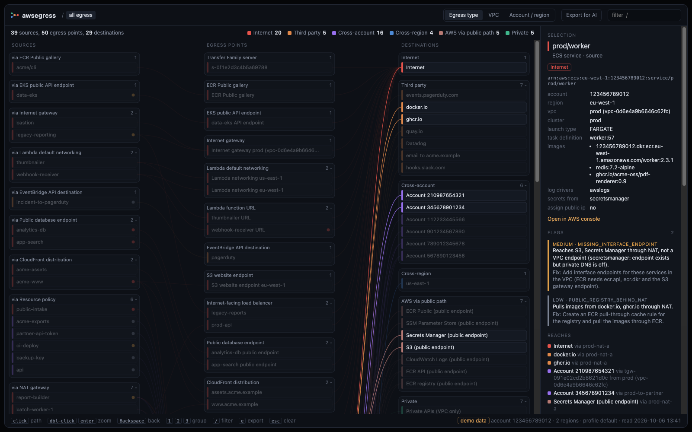

# awsegress

**How can data leave my AWS account?** awsegress reads your account and draws every egress path as a map: sources on the left, egress points in the middle, destinations on the right.



It answers *what* can leave and *how*, not how much. There are no traffic volumes, no costs and no flow logs. It's one Python file with no dependencies to install, and it produces a single HTML page that works offline.

## Quick start

```bash
git clone https://github.com/petricbranko/awsegress && cd awsegress
python3 awsegress.py --demo                  # try it with fake data, no AWS needed
python3 awsegress.py --profile my-profile    # your real account, every enabled region
```

The page opens in your browser. Scanning many regions takes a few minutes; progress goes to stderr:

```
eu-west-1       ec2               ... ok (412 resources)
eu-west-1       kms               ... ok (3 resources, 1 skipped)
global          s3                ... ok (57 resources)
```

## What you get

- **Sources:** EC2 instances, ECS services, EKS node groups, Lambda functions, S3 buckets, snapshots, AMIs, log groups, SNS topics, Firehose streams, databases, and more.
- **Egress points:**
  - Network: NAT gateways and NAT instances, internet and egress-only gateways, transit gateway attachments, peering, VPN and Direct Connect.
  - Internet-facing endpoints: load balancers, CloudFront, API Gateway, Lambda function URLs, Global Accelerator, Transfer Family, public database and EKS endpoints.
  - Resource-level paths: resource policies, snapshot and image sharing, replication, and services that deliver data for you (SNS, EventBridge, Firehose, CloudWatch Logs).
- **Destinations,** colored by kind: internet, third party (with the domain), other AWS accounts (with the account id), other regions, AWS services reached over a public path (NAT instead of a VPC endpoint), and private.
- **Path tracing:** click a node to highlight exactly the flows that go through it. A source shows only its own flows through a shared NAT, not everyone else's.
- **Worth a look:** every finding sorted by severity, each with a one-line fix. Click one to jump to the resource.
- **Not scanned:** services or regions that could not be read (access denied, region not enabled), so you know where the picture is incomplete.
- **Export for AI:** a JSON summary to hand to any AI agent (see below).

Click to trace a path, double-click to zoom into it, `Backspace` to go back, `/` to filter. `1` `2` `3` group by egress type, VPC, or account and region. `e` exports. Large accounts start with groups collapsed: click a group header to expand it.

### Findings

| Severity | What it flags |
|---|---|
| high | Public S3 bucket, public EBS snapshot / RDS snapshot / AMI, Lambda URL with auth `NONE`, publicly accessible RDS / Redshift / OpenSearch, resource policy open to `*` |
| medium | NAT VPC without S3 / DynamoDB gateway endpoint, gateway endpoint missing from private route tables, subnet routed to a NAT in another AZ, private workloads reaching ECR / CloudWatch Logs / Secrets Manager / SSM through NAT, interface endpoint with private DNS off, S3 website hosting, shared snapshots and AMIs, EKS API open to 0.0.0.0/0, public IP in a subnet named private, IAM Access Analyzer findings |
| low | Images pulled from docker.io / ghcr.io / quay.io through NAT (use an ECR pull-through cache), NAT gateway nothing routes to, cross-account and third-party data flows (informational) |

### How routing is resolved

Each subnet uses its explicitly associated route table, or else its VPC's main table. The `0.0.0.0/0` and `::/0` routes decide where a workload's traffic leaves: NAT gateway, NAT instance, internet gateway (only if the workload has a public IP), egress-only gateway, transit gateway, peering or VPN. Routes to specific CIDRs through a transit gateway, peering or VPN are shown too. When a route table has an S3 or DynamoDB gateway endpoint, that traffic counts as private for the subnets using it.

Workload dependencies come from what AWS exposes without logging into the workload:
- **ECS:** task definitions give image registries, the `awslogs` driver, and secrets from Secrets Manager or SSM.
- **EKS node groups:** always pull add-on images from ECR. Pod images need kubeconfig, which awsegress does not use.
- **Lambda in a VPC:** environment values that are Secrets Manager or SSM ARNs. awsegress keeps only the service name, never the values.

## Requirements

- Python 3.8+, plus the [AWS CLI](https://aws.amazon.com/cli/) or `boto3` (boto3 is faster: with the CLI every call is a new process)
- Read access to the account. The AWS managed **ReadOnlyAccess** or **SecurityAudit** policy works. Anything you are not allowed to read shows up under *Not scanned* and the scan carries on.
- Commercial AWS partition (not GovCloud or China)

### Minimal IAM policy

If you'd rather grant only what awsegress calls, use this policy. Every action is read-only.

```json
{
  "Version": "2012-10-17",
  "Statement": [
    {
      "Sid": "AwsegressReadOnly",
      "Effect": "Allow",
      "Action": [
        "access-analyzer:ListAnalyzers",
        "access-analyzer:ListFindings",
        "apigateway:GET",
        "cloudfront:ListDistributions",
        "directconnect:DescribeVirtualInterfaces",
        "dynamodb:DescribeTable",
        "dynamodb:ListGlobalTables",
        "dynamodb:ListTables",
        "ec2:DescribeAddresses",
        "ec2:DescribeCustomerGateways",
        "ec2:DescribeEgressOnlyInternetGateways",
        "ec2:DescribeImageAttribute",
        "ec2:DescribeImages",
        "ec2:DescribeInstances",
        "ec2:DescribeInternetGateways",
        "ec2:DescribeNatGateways",
        "ec2:DescribeNetworkInterfaces",
        "ec2:DescribeRegions",
        "ec2:DescribeRouteTables",
        "ec2:DescribeSnapshotAttribute",
        "ec2:DescribeSnapshots",
        "ec2:DescribeSubnets",
        "ec2:DescribeTransitGatewayAttachments",
        "ec2:DescribeVpcEndpoints",
        "ec2:DescribeVpcPeeringConnections",
        "ec2:DescribeVpcs",
        "ec2:DescribeVpnConnections",
        "ecr-public:DescribeRepositories",
        "ecr:DescribeRegistry",
        "ecr:DescribeRepositories",
        "ecr:GetRepositoryPolicy",
        "ecs:DescribeContainerInstances",
        "ecs:DescribeServices",
        "ecs:DescribeTaskDefinition",
        "ecs:ListClusters",
        "ecs:ListContainerInstances",
        "ecs:ListServices",
        "eks:DescribeCluster",
        "eks:DescribeNodegroup",
        "eks:ListClusters",
        "eks:ListNodegroups",
        "elasticloadbalancing:DescribeLoadBalancers",
        "elasticloadbalancing:DescribeTargetGroups",
        "es:DescribeDomains",
        "es:ListDomainNames",
        "events:ListApiDestinations",
        "events:ListEventBuses",
        "events:ListRules",
        "events:ListTargetsByRule",
        "firehose:DescribeDeliveryStream",
        "firehose:ListDeliveryStreams",
        "globalaccelerator:ListAccelerators",
        "globalaccelerator:ListEndpointGroups",
        "globalaccelerator:ListListeners",
        "kms:GetKeyPolicy",
        "kms:ListAliases",
        "kms:ListKeys",
        "lambda:ListFunctionUrlConfigs",
        "lambda:ListFunctions",
        "logs:DescribeAccountPolicies",
        "logs:DescribeLogGroups",
        "logs:DescribeSubscriptionFilters",
        "rds:DescribeDBClusterSnapshotAttributes",
        "rds:DescribeDBClusterSnapshots",
        "rds:DescribeDBInstances",
        "rds:DescribeDBSnapshotAttributes",
        "rds:DescribeDBSnapshots",
        "rds:DescribeGlobalClusters",
        "redshift:DescribeClusters",
        "s3:GetAccountPublicAccessBlock",
        "s3:GetBucketLocation",
        "s3:GetBucketPolicy",
        "s3:GetBucketPolicyStatus",
        "s3:GetBucketPublicAccessBlock",
        "s3:GetBucketWebsite",
        "s3:GetReplicationConfiguration",
        "s3:ListAllMyBuckets",
        "secretsmanager:GetResourcePolicy",
        "secretsmanager:ListSecrets",
        "sns:GetTopicAttributes",
        "sns:ListSubscriptions",
        "sns:ListTopics",
        "sqs:GetQueueAttributes",
        "sqs:ListQueues",
        "transfer:ListServers"
      ],
      "Resource": "*"
    }
  ]
}
```

## Deep scan

```bash
python3 awsegress.py --profile my-profile --deep
```

Some sharing settings can only be read one resource at a time, so they are off by default. `--deep` adds:
- EBS snapshots and AMIs you own that are public or shared with other accounts
- manual RDS snapshots that are public or shared
- CloudWatch Logs subscription filters that send a log group to another account or region

On large accounts this can mean thousands of calls. Use `--workers N` (default 8) to go faster, or lower it if you get throttled. awsegress retries throttled calls with backoff either way.

## Reopen without AWS calls

Every scan saves its raw data to `out/awsegress-data.json`. Reopen it, or render it again after upgrading awsegress, with no AWS calls:

```bash
python3 awsegress.py --from out/awsegress-data.json
```

## Ask an AI about your egress

```bash
python3 awsegress.py --from out/awsegress-data.json --export
```

This writes `out/awsegress-export.json`. It's a compact summary that includes instructions for the agent:
- every source -> egress point -> destination flow
- every finding, with its fix
- the egress points and destinations
- what could not be scanned

Give it to an AI agent and ask *"review this egress surface: what is exposed or unnecessary?"*. The **Export for AI** button in the page (or `e`) downloads the same file.

## Options

| Flag | What it does |
|---|---|
| `--demo` | Fake data, no AWS access needed |
| `--profile NAME` | AWS profile to use (SSO and `aws login` work) |
| `--regions a,b` | Regions to scan, default every enabled region |
| `--deep` | Also make per-resource calls: snapshot, AMI and RDS snapshot sharing, log subscriptions |
| `--workers N` | Parallel API workers, default 8 |
| `--from FILE` | Reopen saved data without calling AWS |
| `--export [FILE]` | Write the AI summary JSON instead of the page (default `out/awsegress-export.json`) |
| `--out FILE` | Where to write the page (default `out/awsegress.html`) |
| `--no-open` | Don't open the browser |

## Privacy and safety

- **Read-only:** awsegress only calls `Describe*`, `List*` and `Get*` APIs and never creates, changes or enables anything. That includes IAM Access Analyzer: it reads findings from an analyzer you already have and tells you in the page when there is none.
- **Sensitive values are dropped:** webhook URLs are reduced to their host (paths often carry tokens), email subscriptions to their domain, and SMS numbers are dropped. Lambda environment values are never stored.
- **Output is private by default:** everything goes to `out/`, which is git-ignored because it contains account ids and resource names. The page loads nothing from the internet. Share the HTML or export file only with people who should see this.

## Screenshot

`docs/screenshot.png` is the demo data at 1600x1000 in dark mode with `prod/worker` selected. To make a new one, run `python3 awsegress.py --demo`, open the page in a 1600x1000 browser window, click `prod/worker` and take a window screenshot.

## Development

```bash
python3 -m unittest            # route resolution, policies, collectors (with canned responses), flags, export
python3 awsegress.py --demo --no-open
```

The tests also check that awsegress only calls read-only operations. They check every operation and parameter name against botocore's service models too, but only when boto3 is installed.

Not in this version: traffic volumes and costs (edges already have empty `bytes` and `cost` fields for a later traffic mode), walking every account in an organization, and anything that writes to AWS.

awsegress is not affiliated with or endorsed by Amazon Web Services.

## License

[MIT](LICENSE)
